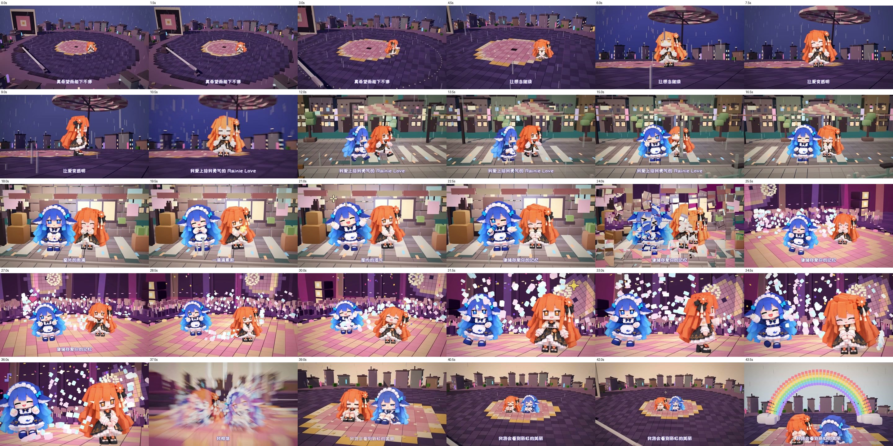

# 《雨爱》完整源码示例

44.375 秒（1065 帧）、1920×1080、24 fps，Claude 与 DeepSeek 两个角色，4 个场景、8 个镜头。故事是一张会下雨的黑胶唱片，经历等待、相遇、舞池与黎明。



## 从哪里开始

- [原始用户提示词](PROMPT.md)：输入是一个 MP4，使用其中的音轨。
- [构思](project/TREATMENT.md)、[镜头与场景源码](project/shots.js)、[计划](project/plan.json)、[风格迭代记录](project/STYLE_FRAMES.md)。
- `preview/`：接触表、逐句帧条、风格对照图。
- `checks/`：原项目保存的报告；动作、转场、体素、场景关通过，不定格检查未发现持续至少 1 秒的定格。局部合拍提示仍可在报告中查看。报告不是本次打包重新运行的结果。
- `manifest.json`：整理时的技能 Git 提交、原始媒体 SHA-256 和运行工具差异。

## 恢复并运行

需要 Python（numpy、Pillow）、Node.js ≥20、ffmpeg/ffprobe、Chrome 或 Edge；角色包需要 `claude` 和 `deepseek`。本例保留原项目运行工具，首次 doctor 会联网安装 Node 依赖。其他操作系统尚未验证。

在技能根目录执行，替换音频路径。目标目录必须不存在：

```powershell
python examples/yuai/prepare.py ../yuai-demo --audio "D:\音乐\雨爱原始片段.mp4"
cd ../yuai-demo
python tools/run.py doctor
python tools/run.py still 14 20 27
python tools/run.py video
```

`prepare.py` 复制保存的源码、从技能的 `characters/` 补入角色帧图，并提取前 1065/24 秒的音轨。MP4 应与原请求的 44.433 秒片段一致；同名歌曲的其他版本不保证与现有歌词和拍点匹配。输入哈希不同时会提示，容许使用从原片提取的音频。替换成另一首歌应重新建项目和设计镜头，不能只替换 `song.wav`。

截图位于 `out/chk/`，最终带音轨成片为 `out/mv.mp4`，交付包位于 `out/交付/`。需要少量修改时，使用 `python tools/run.py video --redo B,C`；修改引擎或全片公共逻辑后应完整重渲染。

## 发布包边界

本目录不包含原始 MP4、提取音轨、带音乐成片、重复角色帧图、node_modules 和渲染缓存。原项目的源码压缩包同样不含音轨和角色帧图，因此提供准备脚本补齐它们。歌词与节拍数据保留用于复现；公开发布前，维护者仍需确认音乐、歌词、角色和预览图各自的分发授权，本说明不授予这些素材的新许可。

引擎和 vendor 与整理时的技能一致。原项目的 `gpu_check.mjs`、`voxel_dump.mjs`、`songmv/probe_dump.mjs` 与技能包有差异，已原样保留，避免替换工具改变复现结果。角色帧图与技能中的对应素材逐文件比较一致。不同浏览器、显卡与依赖版本可能影响画面，不承诺逐像素一致。

历史耗时记录是 `video --redo B,C` 的局部重渲染，不能作为首次完整出片的性能数据。

## 本次复现验证（2026-10-31）

已在新的独立目录执行 `prepare.py`，使用原始 MP4 恢复音轨和两个角色；`doctor` 通过，14、20、27 秒三张样张成功渲染。环境：Windows、Node.js 24.9.0、Python 3.12、numpy 2.4.6、Pillow 12.1.1、Chrome、NVIDIA RTX 3080。技能格式校验、JSON 解析和 Git 空白检查通过。本次没有重新渲染全片，`checks/` 仍为原项目保存的检查结果。
